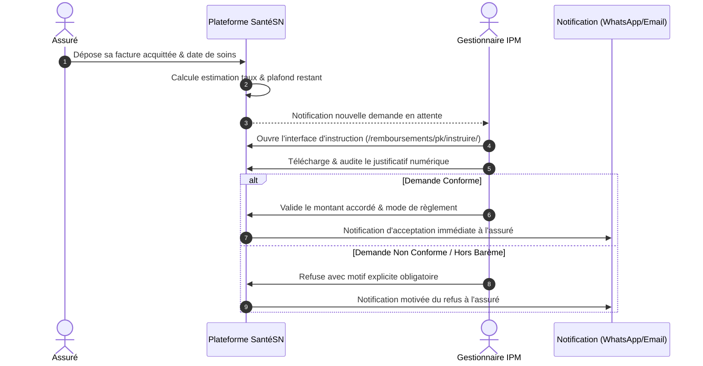

# Espace Gestionnaire IPM & Mutuelle — Liquidation, Conventions et Télétransmission

> Guide complet du portail Gestionnaire SantéSN : liquidation de tiers payant, gestion des conventions de soins, plans de couverture modulaires, instruction des remboursements hors réseau et télétransmission B2B certifiée.

Au sein de l'écosystème SantéSN, le profil **Gestionnaire** représente l'institution d'assurance santé : Institution de Prévoyance Maladie (IPM), mutuelle d'entreprise ou de branche professionnelle, ou compagnie d'assurance privée. Il agit comme tiers de confiance financier et administratif entre les entreprises adhérentes, les assurés (et leurs ayants droit) et les structures de santé conventionnées.

L'Espace Gestionnaire est accessible via l'URL unique `/connexion/` et redirige automatiquement vers le tableau de bord décisionnel dédié `/tableau-de-bord/`.

<Note>
  **Confinement Multi-Tenant strict.** Chaque gestionnaire est rattaché à son propre organisme (`request.user.organisme`). Par conception architecturale, il lui est rigoureusement impossible d'accéder aux contrats, effectifs, conventions ou statistiques financières d'une autre entité d'assurance hébergée sur la plateforme.
</Note>

## Synthèse des modules opérationnels

```
                       ┌──────────────────────────────────────────────┐
                       │          Espace Gestionnaire IPM             │
                       └──────────────────────┬───────────────────────┘
                                              │
         ┌───────────────────┬────────────────┼───────────────────┬───────────────────┐
         ▼                   ▼                ▼                   ▼                   ▼
┌─────────────────┐ ┌─────────────────┐ ┌───────────┐ ┌─────────────────────┐ ┌───────────────────┐
│  Conventions    │ │     Plans de    │ │  Prises   │ │    Instruction      │ │  Télétransmission │
│  Prestataires   │ │    Couverture   │ │ en Charge │ │   Remboursements    │ │   B2B & Exports   │
│ (/conventions/) │ │(/plans-couvert.)│ │  (/pec/)  │ │ (/remboursements/)  │ │(/teletransmiss.)  │
└─────────────────┘ └─────────────────┘ └───────────┘ └─────────────────────┘ └───────────────────┘
```

---

## 1. Liquidation du Tiers Payant

Le cœur de métier du gestionnaire consiste à orchestrer et liquider le tiers payant médical et pharmaceutique en garantissant l'exactitude des calculs et la maîtrise des dépenses de santé.

### Le mécanisme du tiers payant digitalisé

Lorsqu'un assuré se présente chez un praticien ou dans une officine de pharmacie conventionnée :
1. **Identification en temps réel** : Le prestataire scanne le QR Code de la carte d'assuré numérique ou saisit le numéro de sécurité sociale / matricule.
2. **Calcul automatique de la prise en charge** : Le moteur de règles de SantéSN applique instantanément les garanties du plan de couverture associé au patient (ex: 80% pris en charge par l'organisme).
3. **Paiement du ticket modérateur** : L'assuré ne règle immédiatement que sa quote-part (les 20% restants).
4. **Création de la créance tiers payant** : La part prise en charge est enregistrée sous forme de ligne comptable rattachée à la convention du prestataire et mise en attente de liquidation par l'IPM.

### Validation des Demandes d'Accord Préalable (PEC)

Pour les actes médicaux onéreux (hospitalisations, imagerie par résonance magnétique, interventions chirurgicales ou prothèses), un accord préalable est obligatoire :
* **Dépôt dématérialisé** : Le praticien ou la clinique formule la demande d'accord préalable avec devis estimatif et justification médicale.
* **Instruction par le gestionnaire** : Accessible sur `/prises-en-charge/`, le gestionnaire vérifie l'affiliation de l'assuré, le respect du parcours de soins et le plafond annuel résiduel.
* **Génération du Bon de Prise en Charge numérique** : Une fois validé, un bon officiel horodaté avec identifiant unique et QR Code est généré (`/prises-en-charge/<id>/bon/`) et téléchargeable au format PDF sécurisé.

---

## 2. Gestion des Conventions Prestataires (`/conventions/`)

SantéSN permet à chaque organisme de piloter dynamiquement son propre réseau de prestataires conventionnés sur tout le territoire sénégalais (Dakar, Thiès, Saint-Louis, Ziguinchor, etc.).

<CardGroup cols={2}>
  <Card title="Conventionnement dynamique" icon="handshake">
    Création d'accords bilatéraux avec les cliniques privées, hôpitaux publics, cabinets médicaux de spécialité, laboratoires d'analyses et officines de pharmacie.
  </Card>

  <Card title="Statuts contractuels" icon="sliders">
    Gestion fine du cycle de vie de chaque convention : statut `Actif`, `Suspendu` (temporaire lors d'un litige) ou `Résilié`.
  </Card>

  <Card title="Barèmes et Taux négociés" icon="percent">
    Possibilité d'associer des remises ou barèmes tarifaires spécifiques convenus contractuellement avec le réseau de santé partenaire.
  </Card>

  <Card title="Géolocalisation & Annuaire" icon="map-pin">
    Indexation précise des adresses physiques des prestataires conventionnés pour faciliter l'orientation des assurés via l'annuaire cartographique interactif.
  </Card>
</CardGroup>

### Actions d'administration des conventions

Depuis l'interface `/conventions/`, le gestionnaire peut :
* **Ajouter une convention** (`/conventions/ajouter/`) : Sélection du prestataire partenaire, saisie du numéro d'accord, de la date de prise d'effet et des conditions générales.
* **Modifier ou proroger un contrat** (`/conventions/<id>/modifier/`) : Actualisation des avenants, révision des coordonnées de facturation et mise à jour des termes.
* **Basculer le statut en 1 clic** (`/conventions/<id>/statut/`) : Suspension immédiate préventive d'un prestataire suspecté de surfacturation ou réactivation après audit.

---

## 3. Paramétrage des Plans de Couverture Modulaires

L'un des atouts fondamentaux de SantéSN réside dans la flexibilité du modèle `PlanCouverture`. Chaque IPM ou mutuelle peut créer des offres différenciées en fonction des catégories socioprofessionnelles ou des cotisations des entreprises clientes.

| Paramètre du Plan | Description | Exemple typique |
| :--- | :--- | :--- |
| **Nom du Plan** | Libellé public et contractuel de l'offre | *Plan Entreprise Exécutif*, *Plan Cadre 80%*, *Plan Mutuelle Universel* |
| **Taux Consultation** | Pourcentage remboursé sur les visites chez le généraliste ou spécialiste | `80%` ou `100%` |
| **Taux Pharmacie** | Pourcentage de prise en charge des ordonnances de médicaments | `70%`, `80%` ou `90%` |
| **Taux Biologie & Examens** | Prise en charge des analyses sanguines, radiologies, scanners | `80%` |
| **Taux Hospitalisation** | Prise en charge du séjour hospitalier, bloc opératoire et réanimation | `90%` ou `100%` |
| **Plafond Annuel Global** | Montant maximal annuel cumulé de dépenses couvertes par bénéficiaire | `1 500 000 FCFA` / an |
| **Franchise / Ticket Modérateur** | Part minimale incompressible restant à la charge de l'assuré | Déterminée dynamiquement |

### Attribution individuelle ou collective

Le gestionnaire peut attribuer et modifier en masse le plan de couverture d'un groupe de salariés (`/plans-couverture/attribuer/`) ou lors de l'enregistrement individuel d'un bénéficiaire. Le moteur applique automatiquement les nouvelles règles dès la prochaine consultation.

---

## 4. Instruction des Remboursements Hors Réseau (`/remboursements/`)

Lorsqu'un assuré reçoit des soins auprès d'un praticien ou d'une pharmacie hors du réseau conventionné (urgence vitale, éloignement géographique, mission professionnelle ou déplacement à l'étranger), il s'acquitte de la facture et soumet une demande de remboursement dématérialisée.

### Workflow d'instruction pas à pas



### Détail des étapes de décision

1. **Calcul d'aide à la décision automatique** : Dès ouverture du dossier (`/remboursements/<id>/instruire/`), SantéSN analyse le contrat de l'assuré et affiche instantanément :
   * Le taux théorique applicable (ex: 80%).
   * Le montant estimé de remboursement suggéré.
   * Le solde disponible sur le plafond annuel de l'assuré (`plafond_annuel_restant`).
2. **Audit des pièces justificatives** : Le gestionnaire clique sur `Voir le justificatif` pour inspecter la facture originale acquittée, l'ordonnance tamponnée ou la note d'honoraires archivée de manière sécurisée (`telecharger_justificatif_remboursement`).
3. **Arbitrage et Décision** :
   * **Valider** : Approbation du montant calculé ou ajusté manuellement. La demande passe au statut `VALIDEE`.
   * **Rembourser directement** : Validation et constatation simultanée du décaissement effectif. La demande passe au statut `REMBOURSEE`.
   * **Refuser** : Rejet motivé obligatoire (ex: *Délai de forclusion dépassé*, *Prescription non couverte par le contrat*, *Pièce justificative illisible*). La demande passe au statut `REFUSEE`.
4. **Moyens de règlement gérés** :
   * Virement bancaire direct (RIB / IBAN).
   * Chèque bancaire d'assurance.
   * **Mobile Money** : Wave Sénégal, Orange Money, Free Money (très plébiscité pour sa rapidité d'exécution).
5. **Règlement en un clic** : Depuis `/remboursements/<id>/regler/`, le gestionnaire confirme le numéro de transaction et la date de valeur du transfert.

---

## 5. Télétransmission B2B & Rapprochement Comptable (`/teletransmission/`)

La télétransmission B2B élimine les liasses de factures papier et les délais d'encaissement de plusieurs semaines qui pénalisent traditionnellement les prestataires de santé.

### Consolidation périodique automatisée

Le module de télétransmission centralise l'ensemble des actes dispensés en tiers payant :
* **Filtrage calendaire** : Sélection du mois comptable et de l'exercice fiscal (année).
* **Filtrage par structure** : Isolement des factures d'une clinique spécifique, d'une pharmacie ou d'un réseau hospitalier.
* **Séparation des natures d'actes** :
  * Consultations et actes médicaux réalisés par les médecins.
  * Dispensations pharmaceutiques d'ordonnances sécurisées.

### Bordereaux récapitulatifs certifiés

Pour chaque période, SantéSN calcule :
* Le volume total d'actes liquidés.
* Le montant brut global des soins.
* Le total du ticket modérateur encaissé sur place auprès des assurés.
* Le **montant net dû par l'IPM au prestataire de santé**.

### Formats d'exportation standardisés

<CardGroup cols={2}>
  <Card title="Export PDF Officiel" icon="file-pdf" href="https://projet-final-bice.vercel.app/teletransmission/exporter/pdf/">
    Génère un bordereau officiel de liquidation certifié, comportant les en-têtes légaux de l'IPM, la signature numérique, le récapitulatif détaillé des actes et le talon de virement bancaire pour l'ordonnateur des dépenses.
  </Card>

  <Card title="Export Tableur Excel (XLSX)" icon="file-excel" href="https://projet-final-bice.vercel.app/teletransmission/exporter/excel/">
    Exporte l'intégralité des lignes de liquidation formatées (identifiant consultation/ordonnance, matricule patient, date, code acte, montant pris en charge) pour intégration automatisée dans les logiciels de comptabilité générale (Sage, SAP, Odoo, Cegid).
  </Card>
</CardGroup>

---

## 6. Protection du Secret Médical & Sécurité Déontologique

La conception de l'Espace Gestionnaire obéit strictement aux exigences du Code de Déontologie Médicale du Sénégal et de la Loi n° 2008-12 relative à la protection des données à caractère personnel :

* **Cloisonnement hermétique du diagnostic** : Le gestionnaire traite des flux financiers (actes cotés, montants de factures, pourcentages de prise en charge), mais n'a **en aucun cas accès au diagnostic clinique**, aux antécédents médicaux confidentiels ni aux observations rédigées par le médecin traitant.
* **Intégrité et Traçabilité Immuable** : Chaque instruction, validation financière ou suspension de convention est consignée de manière inaltérable dans le modèle `JournalActivite` avec l'adresse IP de l'utilisateur, l'horodatage précis UTC et l'identifiant du compte gestionnaire ayant opéré l'acte.
